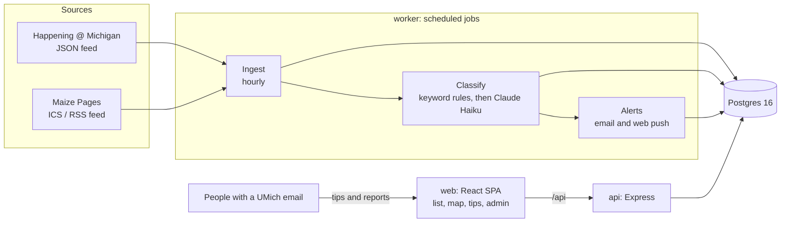

# Maize Bites

Free food at the University of Michigan: what is out right now, today, and this week, on a list
and a map. Maize Bites reads public campus event feeds, works out which events are giving away
food, and lets people with a UMich email share tips, report when the food is gone, and get
alerts.

It is a student project and is not affiliated with the University of Michigan.

## How it works



1. **Ingest.** The worker fetches each enabled source, normalizes events, matches locations to
   campus buildings, and upserts on `(source, source_event_id, occurrence_id)`, so reruns change
   nothing.
2. **Classify.** Keyword rules pick candidates. Claude Haiku confirms each one and extracts the
   food, dietary tags, and who can attend, quoting the listing as evidence. Only confident
   verdicts are published; borderline ones wait for an admin.
3. **Serve.** The API lists published events with filters. The web app shows them on a list and
   a MapLibre map and works offline as a PWA shell.
4. **Crowdsource.** Signed-in users submit tips and report "food's gone". Three such reports in
   an hour fade the event. Admins review tips, override the classifier, and watch pipeline health.

## Repository layout

| Path              | What it is                                                                   |
| ----------------- | ---------------------------------------------------------------------------- |
| `apps/web`        | React, Vite, Tailwind v4, TanStack Query, React Router, MapLibre             |
| `apps/api`        | Express 5 API under `/api`, Zod-validated, cookie sessions                   |
| `apps/worker`     | node-cron jobs: ingestion, classifier, alerts, housekeeping                  |
| `packages/db`     | Drizzle schema, migrations, and every SQL query                              |
| `packages/shared` | Zod schemas and types shared by the API and the web app                      |
| `packages/email`  | Mailer (Resend) and email templates                                          |
| `docs/`           | `sources.md` (data source policy), `progress.md`, the Happening access email |
| `scripts/`        | `check-happening.sh`, a diagnostic for the Happening feed                    |

`CLAUDE.md` holds the conventions the code follows.

## Local setup

You need Node 20.19 or newer, pnpm 10, and Docker.

```sh
cp .env.example .env    # then set INGEST_CONTACT_EMAIL to your address
pnpm install
pnpm dev                # starts Postgres in Docker, applies migrations, runs web, api, and worker
pnpm db:seed            # once: about 50 campus buildings
```

Open http://localhost:5173. The API is at http://localhost:3001/api/health.

Events are published only after the LLM confirms them, which needs `ANTHROPIC_API_KEY`. Without
a key, load sample data instead:

```sh
pnpm db:seed:demo       # about 20 clearly labelled "[demo]" events for today and this week
```

Sign-in is by emailed link. Without `RESEND_API_KEY` the link is printed in the API's log; click
it there. To make yourself an admin:

```sh
docker compose exec postgres psql -U maize -d maize_bites \
  -c "update users set is_admin = true where email = 'you@umich.edu'"
```

## Environment variables

All configuration comes from the root `.env` locally, or the host's environment in production.
`.env.example` documents every variable with a safe placeholder.

| Variable                                                 | Used by     | Required               | Purpose                                                                         |
| -------------------------------------------------------- | ----------- | ---------------------- | ------------------------------------------------------------------------------- |
| `DATABASE_URL`                                           | api, worker | yes                    | Postgres connection string                                                      |
| `WEB_ORIGIN`                                             | api, worker | yes                    | The web app's origin: CORS, CSRF checks, links in email                         |
| `NODE_ENV`                                               | api, worker | no (`development`)     | `production` switches logs to JSON and requires email keys                      |
| `LOG_LEVEL`                                              | api, worker | no (`info`)            | pino level                                                                      |
| `API_PORT`                                               | api         | no (`3001`)            | Port the API listens on                                                         |
| `TRUST_PROXY`                                            | api         | no (`0`)               | Proxy hops in front of the API, for client IPs                                  |
| `INGEST_CONTACT_EMAIL`                                   | worker      | to ingest              | Sent in the User-Agent of every feed request                                    |
| `HAPPENING_ENABLED`                                      | worker      | no (`true`)            | Ingest Happening @ Michigan                                                     |
| `UMICH_INTEGRATION_TOKEN`, `PUBLIC_SITE_URL`             | worker      | for Happening          | Secret token and public site origin for the events.umich.edu integration header |
| `MAIZEPAGES_ENABLED`                                     | worker      | no (`false`)           | Ingest Maize Pages public events                                                |
| `ANTHROPIC_API_KEY`                                      | worker      | to publish feed events | LLM classifier; without it only keyword rules run                               |
| `LLM_MAX_CALLS_PER_RUN`                                  | worker      | no (`100`)             | Cap on LLM requests per hourly run                                              |
| `RESEND_API_KEY`, `EMAIL_FROM`                           | api, worker | in production          | Sign-in links and alert emails                                                  |
| `VAPID_PUBLIC_KEY`, `VAPID_PRIVATE_KEY`, `VAPID_SUBJECT` | api, worker | for push               | Web Push; generate with `pnpm --filter worker vapid:keys`                       |
| `EVENT_RETENTION_DAYS`                                   | worker      | no (`30`)              | Ended events older than this are deleted                                        |
| `PRUNE_INTERVAL_MINUTES`                                 | worker      | no (`60`)              | How often the prune job runs                                                    |

## Scripts

| Command                      | What it does                                                   |
| ---------------------------- | -------------------------------------------------------------- |
| `pnpm dev`                   | Postgres, migrations, then web (5173), api (3001), and worker  |
| `pnpm lint` / `pnpm format`  | ESLint and Prettier check / fix                                |
| `pnpm typecheck`             | `tsc` in every package                                         |
| `pnpm test`                  | Vitest everywhere; database tests use in-memory PGlite         |
| `pnpm test:pg`               | The same tests against real Postgres (starts it with Docker)   |
| `pnpm build`                 | Compile every package to `dist/`                               |
| `pnpm db:generate`           | Generate a migration after editing `packages/db/src/schema.ts` |
| `pnpm db:migrate`            | Apply migrations locally                                       |
| `pnpm db:seed`               | Upsert campus buildings                                        |
| `pnpm db:seed:demo`          | Insert demo events (refuses to run in production)              |
| `pnpm ingest:once`           | One ingestion pass over the enabled sources                    |
| `pnpm --filter worker eval`  | Score the classifier against hand labels                       |
| `scripts/check-happening.sh` | Show how events.umich.edu answers our client                   |

## Data sources and policy

[docs/sources.md](docs/sources.md) records every source we looked at, what its robots.txt and
terms say, and why we do or don't use it. The rules, in short:

- Official feeds only: Happening @ Michigan (JSON) and Maize Pages (ICS, RSS as fallback).
- robots.txt is read first and obeyed. If it can't be read, we don't fetch.
- Every request carries a User-Agent with a contact address. Each source is read at most hourly,
  and Maize Pages only every five hours, as its feed asks.
- Nothing behind a login or UMich single sign-on is collected.
- If a site answers with a bot challenge or a block, we stop and ask its owner. There is no code
  to get past one, and none should be added.

events.umich.edu admits our client with an integration header issued by Student Life Technology
Solutions (see `docs/sources.md`). The token is a secret: it lives in `.env` and the host's
secret store, never in the repository.

## Continuous integration

`.github/workflows/ci.yml` runs on every pull request and push to `main`: install with a frozen
lockfile, lint, typecheck, the test suite on PGlite, the same suite against a Postgres 16 service
container, and a production build.

## Deploying

The repo carries configuration for three hosts. Nothing deploys until you connect them.

1. **Database: Neon.** Create a Postgres 16 project and copy its connection string.
2. **API and worker: Render.** Create a Blueprint from `render.yaml`. It defines two Docker
   services built from `apps/api/Dockerfile` and `apps/worker/Dockerfile`. Enter the values marked
   `sync: false` in the dashboard: `DATABASE_URL`, `WEB_ORIGIN`, the email and push keys,
   `INGEST_CONTACT_EMAIL`, `UMICH_INTEGRATION_TOKEN`, `PUBLIC_SITE_URL`, and `ANTHROPIC_API_KEY`. The API applies migrations before each deploy
   (`node node_modules/@maize-bites/db/dist/migrate.js`). Seed buildings once from your machine:
   `DATABASE_URL=<neon url> pnpm db:seed`.
3. **Web: Vercel.** Import the repo with the root directory set to `apps/web`. In
   `apps/web/vercel.json`, replace `REPLACE-WITH-YOUR-API-HOST.onrender.com` with the API's
   Render hostname. The web app calls `/api/*` on its own origin and Vercel forwards it, so the
   session cookie stays first-party.
4. Set `WEB_ORIGIN` on both Render services to the Vercel URL, with no trailing slash.
5. Point an uptime monitor at `/api/health` and alert when `status` is not `ok`. The response
   lists each source's last successful ingestion.

To build the images yourself, from the repository root:

```sh
docker build -f apps/api/Dockerfile -t maize-bites-api .
docker build -f apps/worker/Dockerfile -t maize-bites-worker .
```
